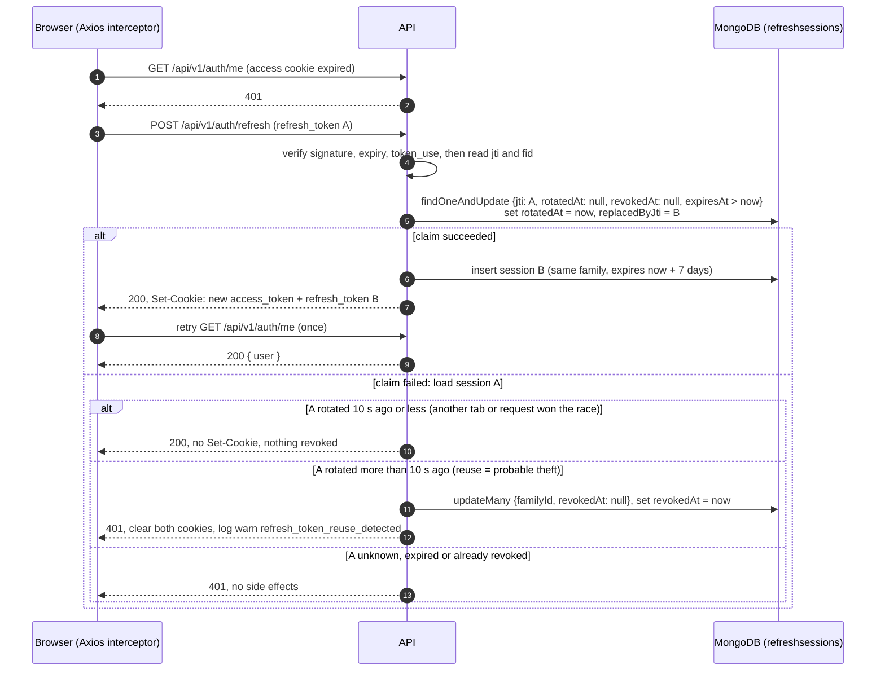

# Easygenerator Auth

Sign-up, sign-in and a protected page, built as the Easygenerator Full Stack Test Task. The API is NestJS + MongoDB, the client is React + Vite, and auth is cookie-only with rotating refresh tokens.

## 1. Overview

- **Sign up** with name, email and password, with a live password checklist.
- **Sign in** with email and password. Unknown email and wrong password are indistinguishable.
- **Protected page** `/app` showing `Welcome to the application.` and `Signed in as {name}`.
- **Stay signed in** with a 15-minute access token and a 7-day refresh token that rotates on every use. Reuse is detected and revokes the whole session family.
- **Log out** revokes this device's session family on the server. Other devices stay signed in.
- **Hardening:** rate limits, Origin check on every unsafe request, Helmet, exact-origin CORS, structured logs with redaction, environment validation at boot, and `Cache-Control: no-store` on every auth response.
- **Ops:** `/api/health`, Swagger at `/api/docs`, Docker Compose, GitHub Actions CI.

## 2. Tech stack

| Area | Stack |
|---|---|
| Runtime | **Node.js 22** (`.nvmrc`) and **npm**. Both apps pin `"packageManager": "npm@11.21.1"`. |
| Server (`server/`) | NestJS 12 (ESM), Mongoose 9, class-validator, Argon2id (`argon2`), `@nestjs/jwt` + Passport, Zod env validation, `nestjs-pino`, Helmet, `@nestjs/throttler`, Terminus, Swagger. Tests: Vitest + Supertest on a real MongoDB. Lint: oxlint. |
| Client (`client/`) | React 19, Vite 8, React Router 7, React Hook Form + Zod, Axios, Tailwind CSS v4, shadcn/ui (`base-nova` style, default theme), sonner. Tests: Vitest, React Testing Library, jsdom. Lint: oxlint. |
| Infra | Docker Compose (`mongo:7`, server, Nginx serving the client), GitHub Actions. |

The two apps are independent, each with its own `package-lock.json`. There are no workspaces and no root lockfile.

npm 10 (bundled with Node 22) can run `npm ci`. Adding or updating dependencies needs npm 11, because npm 10.9.2 crashes on Vite's optional peers and drops the lockfile's `libc` fields: `npm install -g npm@11.21.1`.

## 3. Quick start (Docker)

Requires Docker with Compose v2, and Node.js to generate the secrets. Commands are for a POSIX shell (macOS, Linux, Git Bash, WSL).

```bash
cp .env.example .env
node -e "console.log(require('crypto').randomBytes(48).toString('base64url'))"
node -e "console.log(require('crypto').randomBytes(48).toString('base64url'))"
```

Paste the first value into `.env` as `JWT_ACCESS_SECRET` and the second as `JWT_REFRESH_SECRET`. They must be different and at least 32 characters long. Then:

```bash
docker compose up --build
```

Open <http://localhost:8080>. The client waits until the server's health check passes, so the first start takes a little longer.

Stop with `docker compose down`. Add `-v` to also delete the database volume.

## 4. Local development

1. Create the root `.env` from the [Quick start](#3-quick-start-docker) first. Compose checks the two JWT variables for the whole file, so even `docker compose up -d mongo` fails without them.
2. Start MongoDB only:
   ```bash
   docker compose up -d mongo
   ```
3. Start the API on `http://localhost:3000` (in its own terminal, from the repo root):
   ```bash
   cd server && cp .env.example .env && npm ci && npm run start:dev
   ```
   The placeholder secrets in `server/.env.example` are long enough to boot. Replace them with generated values anyway (same command as above).
4. Start the client (in another terminal, from the repo root):
   ```bash
   cd client && npm ci && npm run dev
   ```
5. Open <http://localhost:5173>. Vite proxies all of `/api` to `http://localhost:3000`, so the browser stays on one origin.

## 5. Environment variables

### Server (`server/.env` for local dev; set in `compose.yaml` for Docker)

Validated with Zod at boot (`server/src/config/env.schema.ts`). Invalid config stops the server with a list of variable names and problems. Values are never printed.

| Variable | Rule | Default | Compose value |
|---|---|---|---|
| `NODE_ENV` | `development` \| `test` \| `production` | `development` | `production` |
| `PORT` | integer 1–65535 | `3000` | default |
| `MONGODB_URI` | required, `mongodb://` or `mongodb+srv://` URI | — | `mongodb://mongo:27017/easygen_auth` |
| `JWT_ACCESS_SECRET` | required, ≥ 32 characters | — | from root `.env` |
| `JWT_REFRESH_SECRET` | required, ≥ 32 characters, **must differ** from the access secret | — | from root `.env` |
| `FRONTEND_ORIGINS` | required, comma-separated exact origins (`scheme://host:port`, no path, no trailing slash, no `*`) | — | `http://localhost:8080` |
| `COOKIE_SECURE` | **required** `true` \| `false`, no default | — | `false` (local HTTP only) |
| `TRUST_PROXY_HOPS` | integer 0–2 | `0` | `1` (Nginx) |
| `LOG_LEVEL` | `fatal` `error` `warn` `info` `debug` `trace` `silent` | `info` | default |
| `SWAGGER_ENABLED` | `true` \| `false` | `true` | default |

With `NODE_ENV=production` and `COOKIE_SECURE=false` the server boots but logs a warning. Token lifetimes and rate limits are constants in code, not environment variables.

### Root `.env` (Docker Compose)

Only `JWT_ACCESS_SECRET` and `JWT_REFRESH_SECRET`. See `.env.example`.

### Client

None required. The Axios base URL is `/api/v1`. `VITE_API_URL` is optional and only for non-default setups (see `client/.env.example`). Never put secrets in `VITE_*`: they end up in browser code.

## 6. Scripts and tests

Run each from its app folder.

| Script | `server/` | `client/` |
|---|---|---|
| `npm run dev` | — | Vite dev server on `:5173` |
| `npm run start:dev` | Nest in watch mode on `:3000` | — |
| `npm run start:prod` | `node dist/main.js` | — |
| `npm run build` | `nest build` → `dist/` | `tsc -b && vite build` → `dist/` |
| `npm run preview` | — | serve the built client |
| `npm run lint` | oxlint | oxlint |
| `npm run typecheck` | `tsc --noEmit` | `tsc -b` |
| `npm test` | unit tests (`src/**/*.spec.ts`) | all client tests |
| `npm run test:e2e` | integration tests (`test/**/*.e2e-spec.ts`) against real MongoDB | — |
| `npm run test:cov` | unit tests with coverage | — |
| `npm run test:watch` | Vitest watch mode | Vitest watch mode |

**Integration tests** need MongoDB on `127.0.0.1:27017` (for example `docker compose up -d mongo`). They use `mongodb://127.0.0.1:27017/easygen_auth_test` unless `MONGODB_URI` is set. **The database name must end in `_test`.** The suite refuses to run otherwise, because it **drops that database** before it starts.

```bash
cd server && npm test && npm run test:e2e
cd client && npm test
```

CI (`.github/workflows/ci.yml`) runs lint, typecheck, test and build for both apps, plus `test:e2e` against a `mongo:7` service and a `docker compose build`.

## 7. API

Base path `/api/v1`. `/api/health` and `/api/docs` are version-neutral. The browser always calls relative `/api/...` URLs.

| Method | Path | Auth | Success |
|---|---|---|---|
| `POST` | `/api/v1/auth/signup` | public | `201 { user }`, sets both cookies |
| `POST` | `/api/v1/auth/signin` | public | `200 { user }`, sets both cookies |
| `GET` | `/api/v1/auth/me` | `access_token` cookie | `200 { user }` |
| `POST` | `/api/v1/auth/refresh` | `refresh_token` cookie | `200 { message }`, rotates both cookies (or none in the grace window) |
| `POST` | `/api/v1/auth/logout` | none (idempotent) | `200 { message }`, clears both cookies |
| `GET` | `/api/health` | public, not rate-limited | `200` Terminus result, `503` if MongoDB is down |

`user` is `{ id, name, email }`. No token ever appears in a response body. Errors share one shape: `{ statusCode, error, message, path, timestamp, requestId }`, and `message` is a `string[]` only for validation errors.

**Swagger:** <http://localhost:5173/api/docs> in dev (through the Vite proxy, so "Try it out" sends an allowed Origin) and <http://localhost:8080/api/docs> in Compose.

**curl and other non-browser clients must send an `Origin` header** on POST requests that exactly matches `FRONTEND_ORIGINS`. Without it the API returns `403 Invalid request origin`. Against the Compose stack:

```bash
curl -i -c cookies.txt -X POST http://localhost:8080/api/v1/auth/signup \
  -H "Origin: http://localhost:8080" -H "Content-Type: application/json" \
  -d '{"name":"Ada Lovelace","email":"ada@example.com","password":"Example!123"}'
curl -i -b cookies.txt http://localhost:8080/api/v1/auth/me
```

In local dev, use `http://localhost:5173` for both the URL and the `Origin` header.

## 8. Auth design

### Cookies

Both tokens travel only in cookies. There is no Bearer auth, and the client's JavaScript never reads, writes or holds a token (no `localStorage`, `sessionStorage`, IndexedDB or in-memory copy).

| Cookie | Lifetime | HttpOnly | SameSite | Path | Secure |
|---|---|---|---|---|---|
| `access_token` | 15 min (`Max-Age=900`) | yes | `Lax` | `/` | `COOKIE_SECURE` |
| `refresh_token` | 7 days (`Max-Age=604800`), renewed on every rotation | yes | `Strict` | `/api/v1/auth` | `COOKIE_SECURE` |

One helper (`server/src/auth/cookies.ts`) builds the options for both setting and clearing, because a browser only clears a cookie when `Path`, `SameSite`, `Secure` and `HttpOnly` match.

**Refresh cookie scope.** `Path=/api/v1/auth` keeps the refresh token off every request except `/refresh` and `/logout` (and `/me`, `/signin`, `/signup`, which share the path but ignore it). The trade-off: the path is tied to `v1`. A future `v2` would re-scope it to `/api/v2/auth`, existing refresh cookies wouldn't reach the new path, and every user would sign in once more.

### Tokens and sessions

- HS256 JWTs with **separate secrets** for access and refresh. Every verification pins `algorithms: ['HS256']`, and each strategy rejects a token whose `token_use` claim is wrong.
- Access JWT: `{ sub, token_use: 'access' }`. Refresh JWT: `{ sub, token_use: 'refresh', jti, fid }`. No email, name or other user data.
- Each signup or signin starts a new **session family** (`fid`), one per device. Every issued refresh token is one `RefreshSession` document holding its `jti`, never the token. A TTL index deletes expired documents.

### Refresh rotation, grace window and reuse detection

When the access cookie expires, the next API call gets 401. The client's Axios interceptor then calls `/refresh` once, even if several requests failed at the same time (single-flight), and retries each original request once. No transactions are used: the claim is one atomic `findOneAndUpdate`, so only one request can rotate a given token.



- If refresh returns 401, the client clears its auth state and sends the user to `/signin`.
- If refresh fails with 429, 5xx or a network error, the client keeps its state and shows a retry option.
- The interceptor never refreshes after a 401 from `/signin`, `/signup`, `/refresh` or `/logout`, and never retries a request twice.
- The grace path gives an attacker nothing: it issues no cookies.

### Logout

`POST /api/v1/auth/logout` verifies the refresh cookie. If it is validly signed, the server revokes **that family only**, so other devices stay signed in. It always clears both cookies and returns 200, even with a missing or garbage cookie. A copied access token stays valid until it expires (at most 15 minutes).

### Why no CSRF tokens

Three layers, each enough for most attacks on its own:

1. **Same origin.** The browser only ever talks to one origin: the Vite proxy in dev, Nginx in Compose. Cookies are never sent cross-site to a different API host.
2. **SameSite cookies.** `Lax` on the access cookie blocks cross-site POSTs from carrying it. `Strict` on the refresh cookie blocks every cross-site request, including top-level navigation.
3. **`OriginGuard`.** Every `POST`, `PUT`, `PATCH` and `DELETE` must carry an `Origin` header that exactly matches `FRONTEND_ORIGINS`. Missing, `null` or mismatched → 403. Browsers always send `Origin` on cross-origin POSTs and can't forge it.

A synchronizer token would add state and client code without closing a gap these three leave open. CORS allows only the exact `FRONTEND_ORIGINS` with credentials and is not counted as a CSRF defence.

## 9. Security decisions

- **Argon2id** (`argon2` library defaults). `passwordHash` is `select: false` and loaded only for signin. Users are mapped to `{ id, name, email }` explicitly; documents are never returned.
- **Dummy-hash timing.** For an unknown email the server still runs `argon2.verify` against a hash of a random string created at startup, so both signin failures take the same code path and cost, and return the same 401 `Invalid email or password`.
- **Password limits.** 8–128 characters, counted in Unicode code points (an emoji is one). The 128 cap and the 10 kB JSON body limit bound the Argon2 CPU cost per request. Signin checks only that the password is non-empty and at most 128 characters, never the policy, so a future policy change doesn't lock anyone out. Passwords are never trimmed.
- **Whitespace counts as "special".** The policy needs a letter (any Unicode letter, e.g. Arabic or accented), a number, and a character that is neither. Spaces and newlines are neither, so `abc 1234` is accepted. The checklist says so: `At least one special character (space counts)`.
- **Same rules on both sides.** Server DTOs and client Zod schemas return identical messages, and both use the same `PASSWORD_RULES` object (one copy per app).
- **Protected by default.** `JwtAuthGuard` is global; routes opt out with `@Public()`. The access strategy reads only the `access_token` cookie, so a `Bearer` header is ignored (tested).
- **Rate limits** (`@nestjs/throttler`): 100 requests / 60 s per IP by default; signup 5, signin 10, refresh 30 per 60 s; health is not limited.
- **Client IP behind Nginx.** The server sets `trust proxy` to `TRUST_PROXY_HOPS` (1 in Compose). The installed `ThrottlerGuard` tracks `req.ip`, which Express derives from the last `X-Forwarded-For` hop that Nginx appends, so a spoofed `X-Forwarded-For` doesn't bypass the limit (checked through Nginx: 11 signins with different spoofed headers → 429 on the 11th).
- **Environment validation.** Boot fails on a missing secret, a secret under 32 characters, equal secrets, a missing `COOKIE_SECURE`, or a non-exact origin. Booleans are parsed from `"true"`/`"false"` strictly, never with `z.coerce.boolean()` (which turns `"false"` into `true`).
- **Logging.** Pino with a request id per request (an incoming `x-request-id` is reused only if it is a UUID) echoed in the response header and in every error body. Cookies, `Authorization`, `Set-Cookie`, passwords, hashes and token fields are redacted (tested). Request bodies are not logged.
- **Errors.** One global filter returns the `ErrorResponse` shape. Unexpected errors return `Internal server error` with no stack or database detail. Malformed JSON gets a fixed message, because Node's own message quotes the request body.
- **No caching of auth responses.** Every `/api/v1/auth/*` response has `Cache-Control: no-store`, so user data never sits in the browser's HTTP cache.
- **Headers.** Helmet defaults on the API (Swagger UI works with them). Nginx adds a strict CSP to the SPA (`default-src 'self'`, no `unsafe-inline`), `X-Frame-Options: DENY`, `nosniff` and `Referrer-Policy: no-referrer`. The only CSP allowance is a `sha256` hash for the one `<style>` block sonner injects; `client/src/csp.test.ts` fails if a sonner upgrade changes it.
- **Containers.** The server runs as the `node` user and its files are root-owned, so the process can't modify itself. Dev dependencies are pruned from the image.
- **Dependency minimum age.** New versions are pinned only once they are at least two weeks old:
  - `cn` is pinned to `0.4.0` and `shadcn` (dev only, used for `shadcn/tailwind.css` at build time) to `4.21.5`. shadcn's registry generates `src/lib/utils.ts` as `export { cn } from "cn"` for every style and CLI version, so pinning the CLI alone doesn't control which `cn` you get, and `cn@0.5.0` was one day old when the client was scaffolded. `src/lib/utils.test.ts` checks the class merging the components rely on.
  - `react-hook-form` is pinned to `7.89.0`, and `sonner` and `next-themes` exactly.
  - GitHub Actions are pinned to commit SHAs (`actions/checkout` v7.0.1, `actions/setup-node` v7.0.0).

## 10. Known limitations

- **Access tokens can't be revoked early.** They are stateless, so a copied access token works for up to 15 minutes after logout or reuse detection.
- **A failed logout request leaves the session active.** Both cookies are `HttpOnly`, so only the server can clear them. If the logout request fails, the client still clears its in-memory state and shows `/signin`. On a network error or a proxy 502/503/504 no clearing `Set-Cookie` reaches the browser, so the refresh cookie stays valid until it expires (7 days, or sooner if the family is revoked), and the next visit signs the user back in. Only an API-generated 500 carries the clearing headers (the server clears the cookies before revoking the family); the client doesn't branch on that. Every failure shows the same warning: "We couldn't confirm sign-out with the server. You may still be signed in on this device. Please try again."
- **The rate limiter is in memory and per instance.** Limits reset on restart and aren't shared between replicas.
- **Signup reveals registered emails.** A duplicate signup returns 409 `Email is already registered`. Accepted for UX; rate limiting slows enumeration.
- **Indexes come from Mongoose `autoIndex`.** Production would manage indexes through migrations.
- **A failed insert after a rotation claim signs the user out.** The old token is already marked rotated, so if inserting the new session fails, the request returns 500 and the user has to sign in again.
- **The grace window trades theft detection for fewer false alarms.**
  - A rotated token replayed within 10 s gets 200 without cookies and doesn't trigger revocation. Reuse is only detected after the window.
  - If a rotation response never reaches the browser, the browser keeps the old token. Its next refresh more than 10 s later looks like reuse, revokes the family, and the user has to sign in again.
  - A request retried after a grace response still carries the old cookies if the winning response hasn't landed yet, so it can fail with 401. The interceptor doesn't refresh a second time.
- **No absolute session lifetime.** Each rotation issues a fresh 7-day refresh token, so an active session never expires on its own.
- **`COOKIE_SECURE=false` in Compose** is only acceptable for local HTTP. Behind HTTPS it must be `true`. Swagger is also enabled in Compose; a real deployment would set `SWAGGER_ENABLED=false`.
- **`npm audit` in the client reports high findings in the shadcn CLI's dev dependency chain** (`braces` via `fast-glob`, `ts-morph`, `@shadcn/registry`). `npm audit --omit=dev` reports none, and the CLI isn't in the built app.
- **Older majors of two client packages.** React Router 8 and jsdom 30 need Node ≥ 22.22, so the client uses React Router 7 and jsdom 29 to keep working on older Node 22 releases.

## 11. Project structure

```text
.
├── .github/workflows/ci.yml   # lint, typecheck, test, build; e2e on mongo:7; compose build
├── specs/                     # the specification this project was built from
├── docs/ai-log.md             # per-phase log of AI-generated work
├── server/
│   ├── src/
│   │   ├── auth/              # controller, service, DTOs, JWT strategies, cookies, refresh sessions
│   │   ├── users/             # User schema, service, safe mapping
│   │   ├── health/            # GET /api/health (Terminus)
│   │   ├── common/            # exception filter, OriginGuard, @Public/@CurrentUser, logger options
│   │   ├── config/            # Zod env schema
│   │   ├── app.module.ts      # global guards, pipe, filter
│   │   ├── app.setup.ts       # HTTP setup shared by main.ts and the tests
│   │   └── main.ts
│   ├── test/                  # integration tests and helpers
│   └── Dockerfile  .env.example
├── client/
│   ├── src/
│   │   ├── app/               # router
│   │   ├── components/ui/     # shadcn-generated
│   │   ├── features/auth/     # API, schemas, AuthProvider, interceptor, forms, route guards
│   │   ├── pages/
│   │   ├── lib/               # Axios instance, utils
│   │   └── test/              # test setup, scripted Axios adapter
│   ├── nginx.conf  Dockerfile  .env.example
├── compose.yaml
├── .env.example               # Compose secrets only
├── AGENTS.md  CLAUDE.md       # instructions for the coding agent
└── AI.md                      # AI usage disclosure
```


